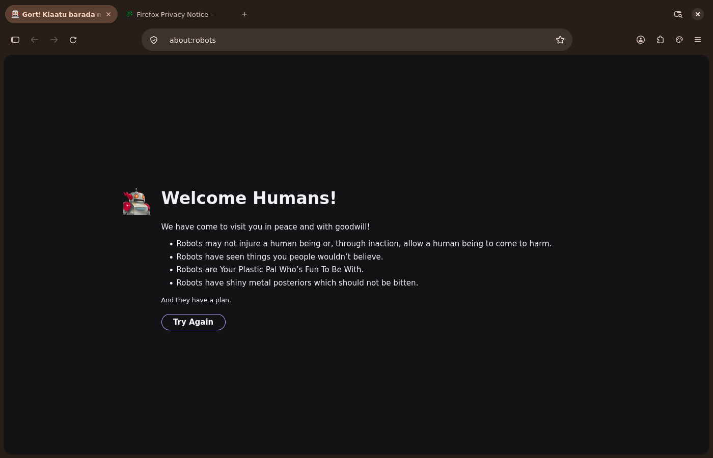
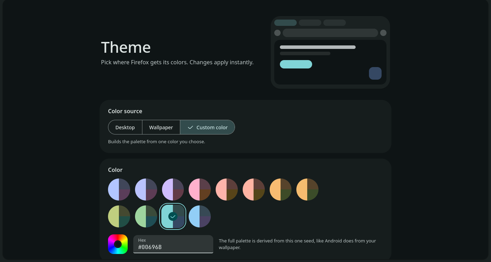

# FMD3: Material You for Firefox

A Material Design 3 (Material You) theme for the Firefox interface. Pill tabs
with tonal highlights, a tall rounded address bar, rounded menus and panels, a
floating page card, and Firefox's own pages (Settings, Add-ons, new tab)
restyled to match. Colors can follow your wallpaper through
[matugen](https://github.com/InioX/matugen), or come from a color you pick in
the built-in theme switcher. Light and dark mode follow your desktop.





Built and tested on Firefox 158 on Linux (Wayland). It overrides Firefox's
design tokens wherever it can instead of styling individual elements, so it
should survive most Firefox updates, but a new major version can still break
details.

## Install

```sh
git clone https://github.com/arcbaseproject/FMD3
cd FMD3
./install.sh
```

Or without cloning:

```sh
curl -fsSL https://raw.githubusercontent.com/arcbaseproject/FMD3/main/install.sh | bash
```

Then restart Firefox. In Settings > Appearance, choose the **System theme —
auto** Firefox theme so light and dark mode follow your desktop. FMD3 replaces
every color either way, but Firefox decides light or dark from that setting.

The installer:

1. Finds the profile Firefox opens by default (`~/.config/mozilla/firefox` or
   `~/.mozilla/firefox`).
2. Moves your existing `chrome/` folder and a copy of `user.js` to
   `fmd3-backup-<date>/` inside the profile.
3. Copies the theme to `chrome/` and turns on the two prefs it needs in
   `user.js` (`toolkit.legacyUserProfileCustomizations.stylesheets` and
   `svg.context-properties.content.enabled`).
4. If matugen is installed, adds the FMD3 templates to
   `~/.config/matugen/config.toml` (your other templates stay untouched) and
   generates a palette from your wallpaper.
5. Installs the theme switcher hook (see below).
6. Installs and enables a daily automatic updater using a systemd user timer.

Options:

| Option | Effect |
|---|---|
| `--list` | Show the Firefox profiles found |
| `--profile <dir or name>` | Install into that profile instead of the default |
| `--wallpaper <image>` | Generate the palette from this image |
| `--no-hook` | Skip the theme switcher hook |
| `--no-auto-update` | Disable automatic updates for this profile |
| `--firefox-dir <dir>` | Firefox install folder, for a Firefox unpacked somewhere unusual |
| `--uninstall` | Remove FMD3 and restore the backup |

Running `./install.sh` again updates the theme in place and keeps your colors.
Updates also keep custom files and additions below the override comments in
`userChrome.css` and `userContent.css`. A full copy of the previous `chrome/`
folder is saved in `fmd3-update-<date>-<suffix>/` before each update; edits to
other bundled files can be recovered there.

## Automatic updates

The installer enables `fmd3-update.timer` when `git`, `flock`, `sha256sum` and
`systemctl` are available. It checks GitHub's `main` branch daily, with up to
one hour of randomized delay. Missed checks run after the next user login.
Restart Firefox after an update to load the new styles.

The updater keeps its own checkout under `~/.config/fmd3/repository` and
leaves your development checkout untouched. It applies new commits to each
registered profile through the downloaded installer, preserving palettes,
custom overrides and update backups. Unchanged commits are skipped. Failed
downloads leave installed profiles untouched and are retried on the next run.
Automatic runs never install the system hook or regenerate wallpaper colors.
The updater also refreshes itself and existing matugen templates.

To check immediately or view logs:

```sh
systemctl --user start fmd3-update.service
journalctl --user -u fmd3-update.service
```

Run `./install.sh --no-auto-update` to opt the selected profile out. Uninstall
also unregisters that profile; the timer is disabled and its unit files removed
when the last registered profile is removed. The cached checkout stays on disk.
Paths under `~/.config` honor `XDG_CONFIG_HOME`. Without a working systemd user
session, the installer reports that scheduling failed; the theme still installs.

## Theme switcher

A page inside Firefox for choosing colors, with no restart. Open it with the
palette button in the toolbar, or at `chrome://m3theme/content/switcher.html`.

- **Desktop**: use the matugen palette files.
- **Wallpaper**: build the palette from your current wallpaper
  (DankMaterialShell's), rebuilt each time Firefox starts.
- **Custom color**: 12 presets, a color picker or a hex value. The full
  palette is derived from that one color.
- **Style**: matugen's scheme types: Tonal spot, Vibrant, Expressive,
  Fidelity, Content, Rainbow, Fruit salad, Neutral and Monochrome.
- **Contrast**: Standard, Medium or High.
- **Floating page**: show websites in a rounded card, or edge to edge.

The Wallpaper and Custom options need matugen installed.

### The hook

A normal page cannot restyle Firefox, so the switcher needs a few lines in
Firefox's startup config (`mozilla.cfg`, Firefox's "autoconfig"). They register
the `chrome/m3/switcher/` folder from your profile and load it. All the logic
stays in that folder, so updating the theme never touches the hook again. If
the folder is missing, the hook does nothing. The same hook also shows the
search engine logo as a monochrome glyph in the address bar.

- **Regular Linux packages** (Arch, Fedora, Debian, Mozilla's tarball): the
  installer writes `defaults/pref/fmd3-autoconfig.js` and `mozilla.cfg` into
  the Firefox folder, with sudo if needed. An existing `mozilla.cfg` is kept
  and the FMD3 block is appended. A Firefox update from your package manager
  may remove these files; run `./install.sh` again if the palette button
  disappears.
- **NixOS**: the Firefox package is read-only. Add the block from
  [`nixos/firefox-hook.nix`](nixos/firefox-hook.nix) to
  `/etc/nixos/configuration.nix`, remove `firefox` from
  `environment.systemPackages` if it is there, and run
  `sudo nixos-rebuild switch`.
- **Snap and Flatpak**: no hook is possible. Everything except the switcher
  page and the monochrome engine logo still works.

Without the hook, the rest of the theme works as usual.

## Wallpaper colors with matugen

The templates in `matugen/` write `chrome/m3/palette.generated.css` (browser
UI) and `chrome/m3/pages.palette.generated.css` (Firefox's own pages). If
those files do not exist, a built-in palette is used.

Regenerate by hand:

```sh
matugen image ~/Pictures/wallpaper.png -c ~/.config/matugen/config.toml --prefer saturation
```

[DankMaterialShell](https://github.com/AvengeMedia/DankMaterialShell) runs the
templates in `~/.config/matugen/config.toml` whenever the wallpaper changes
when "Run user templates" is on. Firefox reads the files at startup.

## Layout

```
chrome/
├── userChrome.css          browser UI entry point
├── userContent.css         entry point for Firefox's own pages
└── m3/
    ├── tokens.css          color roles, shape, type, elevation, motion
    ├── bridge.css          maps M3 roles onto Firefox's design tokens
    ├── frame.css           toolbox, toolbar buttons, bookmarks bar, page card
    ├── tabs.css            pill tabs, tab groups, vertical tabs
    ├── omnibox.css         address bar and results
    ├── menus.css           context menus, app menu, panels
    ├── panels.css          downloads, extensions, site info
    ├── sidebar.css         sidebar
    ├── pages.css           Settings, Add-ons and other about: pages
    ├── newtab.css          new tab page
    ├── *.static.css        built-in palette for those pages
    ├── icons/              SVG filter for monochrome logos
    └── switcher/           theme switcher page and its startup code
matugen/                    matugen templates and config
nixos/firefox-hook.nix      the hook for NixOS
autoconfig/                 the hook for other Firefox installs
install.sh
```

All colors come from the `--md-sys-color-*` roles in `m3/tokens.css`. Nothing
else hardcodes a color, so editing that file (or the matugen output) recolors
everything. Add your own CSS at the end of `userChrome.css`.

## Options in about:config

| Pref | Effect |
|---|---|
| `m3.content.flat` (boolean) | `true`: page fills the window, no floating card |
| `browser.uidensity` | `0` normal, `1` compact. Both work |
| `sidebar.verticalTabs` | Vertical tabs become full-width pills in the sidebar |

The theme respects `prefers-reduced-motion`.

## Websites

FMD3 never changes how websites look. Every `userContent.css` rule is scoped
to Firefox's own pages with `@-moz-document`, and the `--md-sys-color-*`
variables are never defined on websites (sites built with Material Web read
those names).

## Uninstall

```sh
./install.sh --uninstall
```

This restores the `chrome/` folder and `user.js` from the backup and removes
the FMD3 matugen templates. Profiles without the FMD3 installation marker are
left untouched. The shared startup hook stays installed for other profiles;
it does nothing in profiles without the switcher files. On NixOS, remove the
`programs.firefox` autoconfig block and rebuild only after all profiles using
the switcher have been uninstalled.
